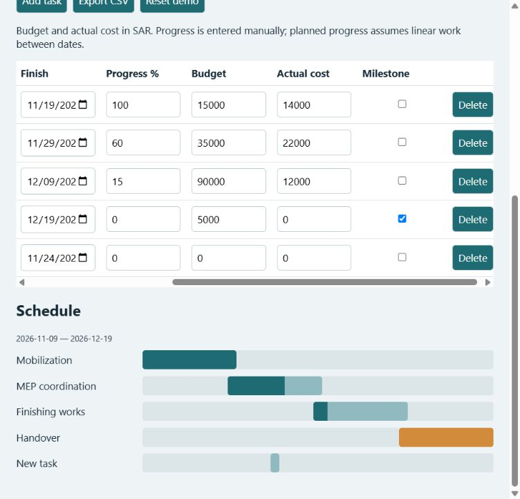

# BuildTrack
A dependency-free browser prototype for construction project controls. Open `index.html` or deploy the files to GitHub Pages.

Edit tasks, dates, budget, actual cost and completion percentage. The reporting date controls planned progress, assuming linear progress across each task. Budget-weighted actual progress is earned value divided by total budget. SPI = earned value / planned value; CPI = earned value / actual cost. Undefined ratios are displayed as a dash. All costs use SAR. Milestones are visual flags, not dependency constraints. Data is saved locally in the browser; CSV export is available. Reset replaces local data with synthetic examples.

Limitations: no critical path, dependencies, resource leveling, multi-user collaboration or audited financial controls. This is a prototype, not a replacement for Primavera or professional project controls. No client data is included.

Contributions and bug reports are welcome. MIT license.

[Open the live demo](https://ameer93emad-dev.github.io/construction-project-dashboard/)

## Try the demo

Move the reporting date while keeping the task inputs fixed. Planned progress changes with the date. Actual progress comes from the completion percentages you enter. The starting tasks, costs and dates are demonstration data.

